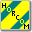
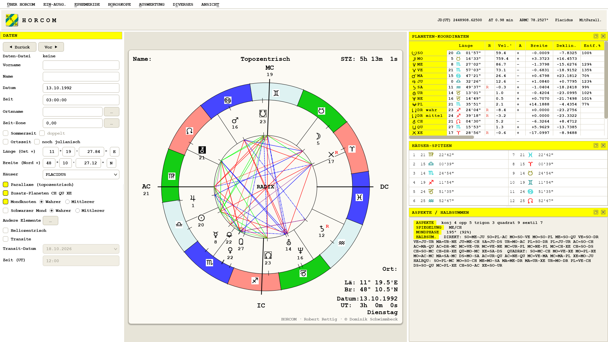

<p align="center">
  
</p>

<h1 align="center">horcom</h1>

<p align="center">
  <a href="https://github.com/horcom-rr/HORCOM/releases/latest"></a>
  <a href="https://github.com/horcom-rr/HORCOM/releases"></a>
  <a href="https://horcom-rr.github.io/HORCOM/"></a>
  
  <a href="LICENSE"></a>
</p>

**HORCOM** is a complete astrology program for the desktop. It casts and draws birth charts, follows transits and directions, computes solar, lunar and planetary returns, compares two people, and walks the seven year phases of the Munich rhythm theory. **Robert Rettig** wrote and refined it from about 1989 until 2010. This is his program on today's Windows and Linux, free and open source.

<p align="center">
  
</p>

<p align="center">
  <b><a href="https://github.com/horcom-rr/HORCOM/releases/latest">Download for Windows or Linux</a></b>
  &nbsp;·&nbsp;
  <a href="https://horcom-rr.github.io/HORCOM/tutorial.html">Tutorial</a>
  &nbsp;·&nbsp;
  <a href="https://horcom-rr.github.io/HORCOM/">Handbook</a>
</p>

## What it does

- **Charts:** birth charts in seven house systems (Placidus, Topocentric, Koch, Regiomontanus, Campanus, Equal from the ascendant, Vehlow), optionally with topocentric positions (parallax) for an observer on the Earth's surface, the true or mean lunar node and Black Moon, Chiron, Quaoar, Eris (Xena), the asteroids and the Hamburg points, and heliocentric and mundane views.
- **Transits and directions:** transits and mundane aspects as tables, chart rings and linear graphs, secondary and solar arc directions, primary directions after E. C. Kühr, symbolic directions, multiple directions and harmonics, and the dynamogram after Krafft-Goerner.
- **Returns:** solar, lunar, planetar and personar returns, solar and lunar lists of up to 84 returns, and the terrar in heliocentric mode.
- **Munich rhythm theory:** the seven year phases of the Döbereiner school, septars, trigger tables and the degree date list.
- **Two people:** double wheel, the 90 degree dial, composite and combine charts.
- **Tables:** planet coordinates with distances, fixed stars, Arabic parts, ingresses of every planet and of MC and AC, eclipses, rise and set times, the great (Platonic) year.
- **Research:** a statistics module that searches whole chart collections by position, sign, house, aspect or midpoint.
- **Your data:** chart collections in Robert Rettig's data files and the AAF exchange format, a places catalogue, and historical time zones for many countries.
- **Output:** printing on A5 or A4, PDF, SVG and PNG export, with Robert's own commentary texts under every menu.
- **Comfort:** side panels for coordinates, house cusps and aspects, adjustable text size, black on white or a night sky look, German and English.

The [tutorial](https://horcom-rr.github.io/HORCOM/tutorial.html) walks through the program, from the first chart to transits, returns, directions and printing.

## Download and installation

Every new version appears on the [releases page](https://github.com/horcom-rr/HORCOM/releases/latest). Versions are numbered 0.x until the 1.0 release. The [installation guide](https://horcom-rr.github.io/HORCOM/install.html) in the handbook has the details.

### Windows

1. Download `horcom-windows-x64.zip` from the [latest release](https://github.com/horcom-rr/HORCOM/releases/latest).
2. Unpack it into a folder of your choice, for example `Documents\HORCOM`.
3. Start `horcom_gui.exe`. Keep the `data` folder beside it, your settings and chart collections are stored there.

To update, unpack a newer release over the old folder, your own files are kept. To uninstall, delete the folder.

Windows may warn about an unknown publisher the first time you start the program. This is normal for a free program without a paid signing certificate and says nothing about the program itself. Click **More info**, then **Run anyway**.

### Linux

Download `horcom-linux-x86_64.AppImage`, make it executable and start it. It runs on any current 64 bit desktop (Ubuntu 22.04 or newer, Debian 12, Fedora, Arch, openSUSE and relatives) and installs nothing into the system.

```sh
chmod +x horcom-linux-x86_64.AppImage
./horcom-linux-x86_64.AppImage
```

If it does not start and mentions FUSE, install `libfuse2t64` (Ubuntu 24.04), `libfuse2` (Ubuntu 22.04, Debian) or `fuse-libs` (Fedora). Your settings and files live in `~/.config/horcom` and `~/.local/share/horcom/data`, so replacing the AppImage with a newer one keeps them.

## About Robert Rettig and HORCOM

HORCOM was Robert Rettig's life project. He began it on the Atari ST and carried it to Windows, written in GFA BASIC, and distributed it on CD and through his website. It grew into a complete professional astrology suite. He did not stop at the standard planets. When no ephemerides existed for bodies he cared about, he computed his own, integrating the orbits of Chiron, Pholus, Nessus, Damokles, Quaoar, Eris and Halley's comet and shipping the results for centuries. He wrote the interpretation texts, the statistics module, the historical time zone tables for dozens of countries and the places database himself.

He wished for HORCOM to live on. This version keeps his menus, dialogs, screens and calculations, and every result is checked against his original program.

## For developers

The rest of this page is about the source code. Every ported routine is checked against Robert Rettig's original, and his own comments travel with the C++ code.

- [`docs/architecture.md`](docs/architecture.md) explains the C++ design, the verification strategy, every deliberate deviation from the original and every bug of the original that was fixed.
- [`docs/legacy/`](docs/legacy) maps the original program (50,397 lines, 1,095 procedures), its astronomical engine, menu tree and screen geometry, file formats and ephemeris production chain. [`docs/coverage.md`](docs/coverage.md) accounts for every procedure by name.
- The technical pages of the [handbook](https://horcom-rr.github.io/HORCOM/) describe each module of the new program.
- The tests compare against Meeus's worked examples, his binary data files, independent cross computations and output recorded from the original program.

### Principles

- The original program defines correct behaviour. Where the rewrite deviates, the deviation is documented.
- Robert Rettig's own comments are carried over into the C++ code wherever they still apply, in his words.
- Personal data from the original archive (chart collections, customers, keys) never enters this repository.

### Repository layout

| Path | Purpose |
|---|---|
| `src/` | The C++ implementation |
| `apps/` | The `horcom` command line tool and the `horcom_gui` Qt desktop program |
| `tests/` | Tests, including comparisons against the original program's results |
| `data/` | His ephemerides, term tables, place and zone catalogues, and his original commentary texts (`data/kommen/`) |
| `packaging/` | Linux desktop entry, AppStream metadata and the AppImage build script |
| `docs/` | Architecture notes, the map of the original program and the handbook (`docs/handbook/index.html`) |
| `reference/` | Verified UTF-8 copies of his original GFA BASIC listings, the factual base of the port (local only, not in git) |
| `legacy/` | The complete original archive, programs, data and documents (local only, not in git, contains private data) |

### Command line

The `horcom` command line tool computes a chart without the desktop program:

```
build\apps\horcom.exe --date 13.10.1992 --time 03:00 --lon 11.32 --lat 48.17 --extras --svg wheel.svg
```

### Building from source

A C++20 compiler and CMake 3.25 or newer build the library, the `horcom` command line tool and the tests. Qt 6 with Widgets, Svg, PrintSupport and the Linguist tools additionally builds the desktop program, the target is skipped where Qt is absent. Warnings are errors on every compiler. Every push builds and tests on Windows and Linux and publishes a release.

**Windows** (MSVC 2022, Qt 6.8 for MSVC). `build.bat` configures, builds and tests in one go, or by hand:

```
cmake -S . -B build -G Ninja -DCMAKE_BUILD_TYPE=Release -DCMAKE_PREFIX_PATH=C:/Qt/6.8.3/msvc2022_64
cmake --build build
ctest --test-dir build --output-on-failure
```

**Linux** (GCC 12+ or Clang 18+, the distribution's Qt 6). Install the dependencies, then run `./build.sh` from the repository root, which configures, builds and tests. `QT_PREFIX=~/Qt/6.8.3/gcc_64 ./build.sh` uses a Qt outside the system.

| Distribution | Dependencies |
|---|---|
| Ubuntu 24.04, Debian 12 | `sudo apt install build-essential cmake ninja-build libgl-dev qt6-base-dev qt6-svg-dev qt6-tools-dev qt6-tools-dev-tools qt6-l10n-tools` |
| Fedora | `sudo dnf install gcc-c++ cmake ninja-build qt6-qtbase-devel qt6-qtsvg-devel qt6-qttools-devel` |
| Arch | `sudo pacman -S base-devel cmake ninja qt6-base qt6-svg qt6-tools` |

The built programs find the `data` folder of the checkout by themselves. `sudo cmake --install build` installs system wide in the usual layout (binaries in `bin`, data in `share/horcom/data`, desktop entry, AppStream metadata and icons), `packaging/linux/appimage.sh` builds the release AppImage. MSVC, GCC and Clang produce byte identical chart output.

### Verifying a download

Every release ships a `SHA256SUMS.txt` written by the build pipeline. On Windows `Get-FileHash horcom-windows-x64.zip` in PowerShell prints the value to compare, on Linux `sha256sum -c SHA256SUMS.txt --ignore-missing` checks it. [Gear Lever](https://github.com/mijorus/gearlever) or AppImageLauncher add the AppImage to the application menu and keep it updated through the `.zsync` file of each release.

<p align="center">
  <a href="https://github.com/horcom-rr/HORCOM/actions/workflows/build.yml"></a>
  
  
</p>

## License

GPL-3.0-or-later, see `LICENSE`. HORCOM stays free and open, every derivative stays open, and Robert Rettig's name stays attached to his work. Rewritten in C++ and maintained by Dominik Schwimmbeck.

---

<p align="center">Thanks to Robert's close friend André, who made this possible.</p>

<p align="center"><i>In loving memory of Ingrid &amp; Robert Rettig ❤️</i></p>
